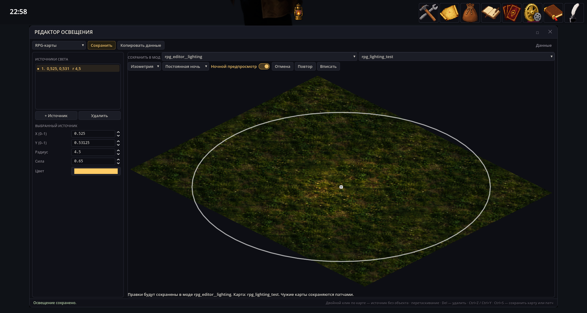
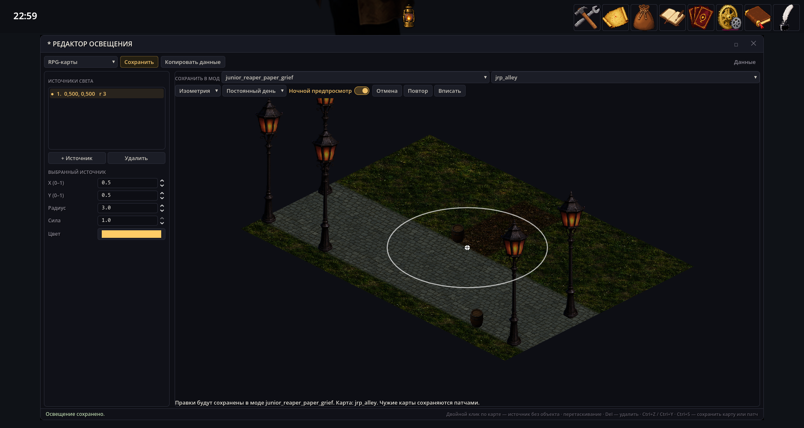
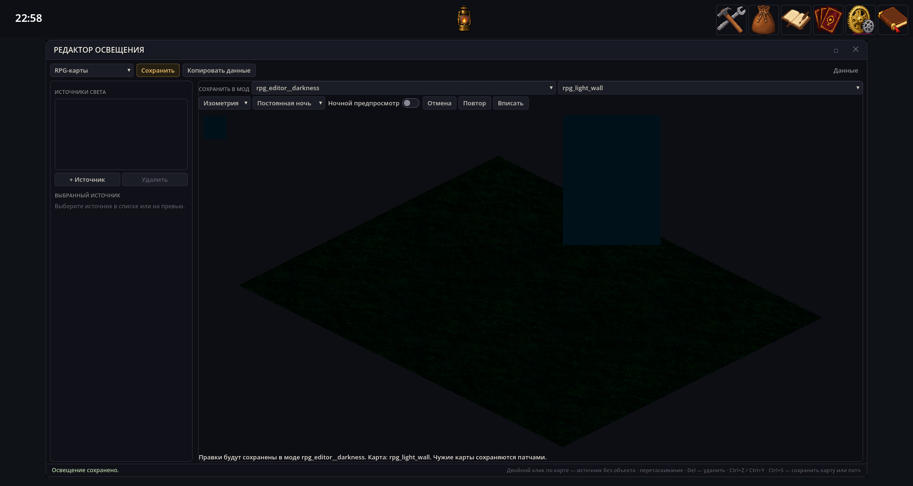
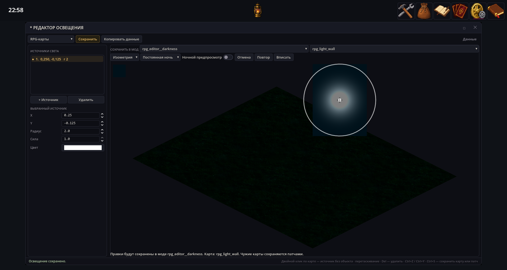

# Light Editor — static lights of a scene, placed on a night preview

Night scenes of `time_base` are lit by the `light_set` line of a scenario. The Light Editor turns that line into points you drag on the scene's background: the preview is rendered with the game's own night shader, so what you see is how the scene will look after dark.

## Opening it

Hammer button on the in-game toolbar → **Light Editor**.

## Placing lights

1. Choose the scenario whose `light_set` line you edit (● marks scenarios that already set lights). Its scene's background is shown; **Preview background** picks another.
2. Double-click the background (or **+ Light**) to add a light, drag lights to move them, Del deletes the selected one. At most 10 static lights.
3. **Selected light**: **X**/**Y** (0–1 of the screen), **Radius** (pixels of the 1920 px game screen), **Strength** (0–1) and **Colour**.
4. Ctrl+S writes the `light_set` line into the scenario; a scenario without one gets it inserted after its header. **Copy line** puts the command on the clipboard instead, to paste it by hand.

## Lights on RPG maps without scenery objects

When the game includes both `light_editor` and `rpg_editor`, choose **RPG maps** in this window's first selector. The optional `rpg_editor__lights` integration supplies the map surface; this is the same light editor used for dialog backgrounds.

1. Choose **Save to mod**, then an own map or a map supplied by that mod's dependencies.
2. Double-click the map or press **+ Light** to create a light without a picture, object, collision or interaction. This can illuminate a lamp or window already painted into the scenery.
3. Drag a marker; X/Y use the map as a coordinate basis but are not clamped to its floor: walls and artwork may use negative values or values above 1. Radius is circular on the projected image, in cell-sized units, and Strength and Colour use the existing controls. Top-down/isometric switching preserves positions. Del deletes; Ctrl+Z / Ctrl+Y undo and redo, with one history step per drag.
4. **Night preview** changes only the preview. The adjacent saved map mode can follow game time or fix day/night. Fixed day saturates the lighting, so extra sources are not visible then.
5. **Save / Ctrl+S** writes the map resource or a normal `rpg_map` patch in the chosen mod. Dependency source files remain unchanged, and the running game reloads its lighting.

Stable source ids let dependent mods edit, add and remove individual lights without replacing the owner's list. Stored maps may contain more than 16 lights; the renderer selects the nearest 16 at runtime.

## Limits

- Folder mods only; packed scenarios cannot be written (the line can still be copied).
- Lights follow the scenario: another scenario of the same scene may set different ones.

## Dependencies

`tools_base`, `time_base`, `ui_base`, `scenario_tools_base` (reads scenarios; the Scenario Editor window is not needed).
The older `editor_tools` package installs this mod together with the other authoring windows.

## Wall sources and detective darkness

Double-click directly on wall or window artwork, including above the walkable floor. Free sources illuminate the image with a circle in either projection. Their positions survive camera movement, saving and normal keyed resource patches. Night uses the same deep palette as novel backgrounds; the shared toolbar lamp reveals otherwise hidden details and removing it conceals them again.

