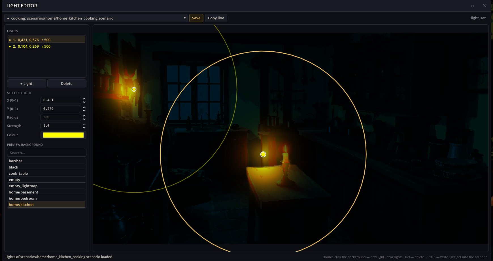

# 조명 에디터 — 밤 미리보기 위에 장면의 고정 조명 배치

`time_base`의 밤 장면은 시나리오의 `light_set` 줄로 밝혀집니다. 조명 에디터는 이 줄을 장면 배경 위에서 끌 수 있는 점으로 바꿉니다. 미리보기는 게임 자체의 밤 셰이더로 그려지므로 해가 진 뒤 장면이 어떻게 보일지 그대로 확인할 수 있습니다.

## 여는 방법

게임 툴바의 망치 버튼 → **조명 에디터**.

## 조명 배치

1. `light_set` 줄을 편집할 시나리오를 고릅니다(●는 이미 조명을 설정하는 시나리오). 그 장면의 배경이 보이며 **미리 보기 배경**으로 다른 배경을 고를 수 있습니다.
2. 배경을 더블클릭(또는 **+ 조명**)하면 조명이 추가되고, 끌어서 옮기며, Del로 선택한 조명을 지웁니다. 고정 조명은 최대 10개입니다.
3. **선택한 조명**: **X**/**Y**(화면의 0–1), **반지름**(폭 1920 px 게임 화면의 픽셀), **세기**(0–1), **색**.
4. Ctrl+S는 `light_set` 줄을 시나리오에 씁니다. 줄이 없는 시나리오에는 헤더 뒤에 삽입됩니다. **줄 복사**는 대신 명령을 클립보드에 넣어 직접 붙여 넣을 수 있게 합니다.

## 제한

- 폴더 모드만 가능하며, 패키지된 시나리오에는 쓸 수 없습니다(줄은 복사할 수 있음).
- 조명은 시나리오를 따릅니다. 같은 장면의 다른 시나리오가 다른 조명을 설정할 수 있습니다.

## 의존성

`tools_base`, `time_base`, `ui_base`, `scenario_tools_base`(시나리오를 읽음, 시나리오 에디터 창은 필요 없음).
예전 `editor_tools` 패키지는 이 모드를 다른 제작 창과 함께 설치합니다.

## RPG 맵 조명

`light_editor`, `rpg_editor`를 함께 로드하면 `rpg_editor__lights`가 **RPG maps**를 추가합니다. 저장 모드와 맵을 고르고 더블클릭 또는 **+ Light**로 물체나 충돌 없는 광원을 만듭니다. 표시를 끌어 이동하세요. X/Y는 맵 기준이며 바닥 밖 벽을 위해 0–1 밖도 허용합니다. 반지름은 칸 단위이고 화면에서는 원형입니다. Del 삭제, Ctrl+Z/Y 취소·복구이며 한 드래그가 한 단계입니다.

**Night preview**는 미리보기만 바꿉니다. 저장 모드는 시계 순환 또는 고정 낮·밤입니다. 고정 낮은 조명을 포화시키고 램프를 숨깁니다. Save는 자신의 맵 또는 `rpg_map` 패치에 쓰며 의존 모드 원본은 보존합니다. 고정 ID로 광원별 패치가 가능합니다. 16개 넘게 저장할 수 있지만 렌더러는 가까운 16개를 고릅니다. 도구 모음 램프는 게임과 공유하며 위치, 반지름, 강도를 씁니다.
